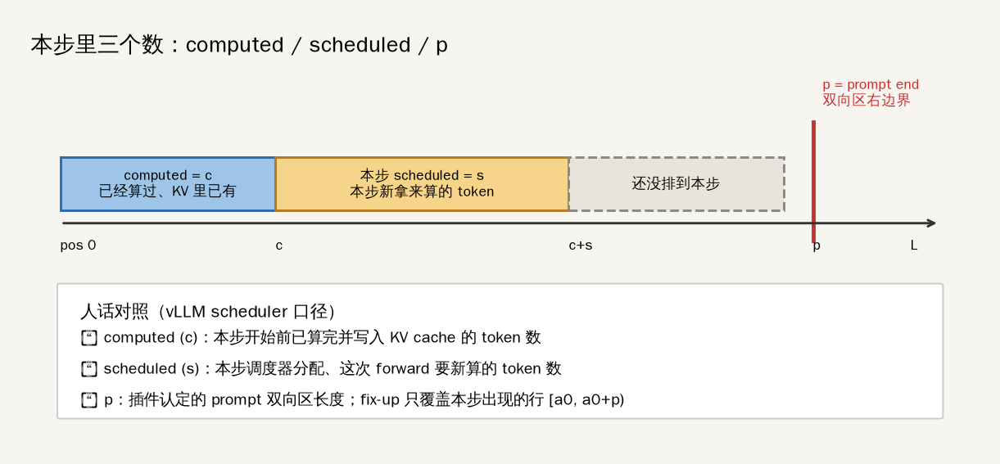
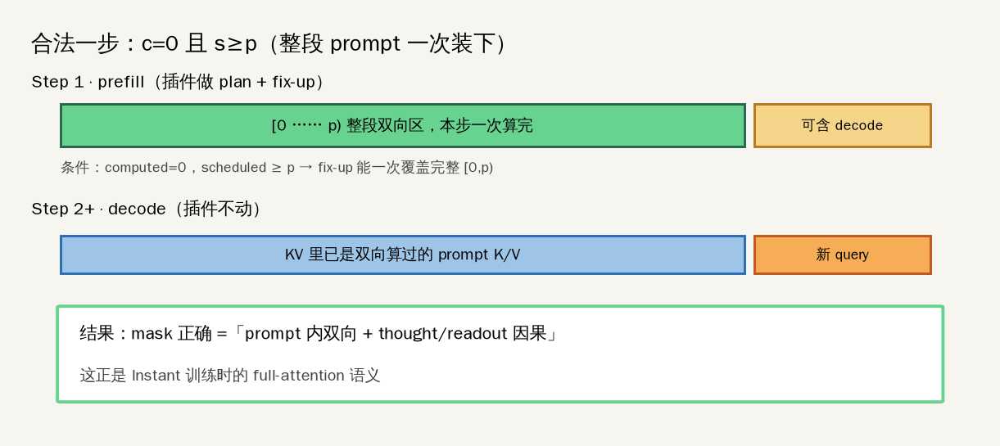
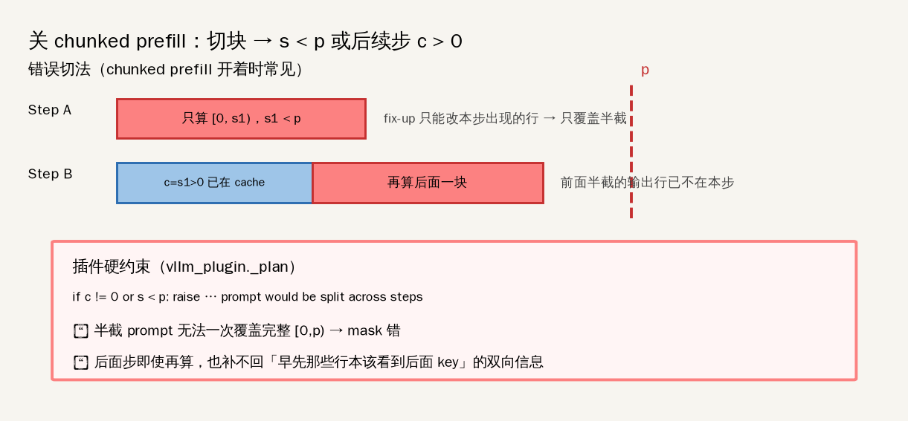
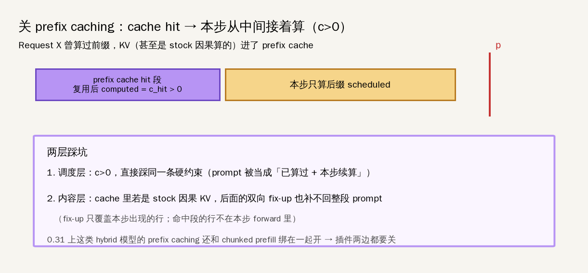
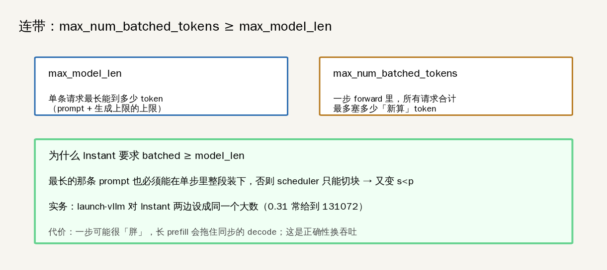

# 为何 Instant 必须关掉 chunked prefill / prefix caching

> 范围：vLLM 插件 `startlux_prefix_bidir`（`startlux_decide/vllm_plugin.py`）对 **Instant**（`jev_prompt_attention: bidirectional`）的引擎硬约束。  
> 配图目录（一文一图）：[`docs/03-为何关掉chunked-prefill与prefix-caching/`](./03-为何关掉chunked-prefill与prefix-caching/)  
> 正本机制总览：[`docs/vllm_bidirectional.md`](./vllm_bidirectional.md)、[`docs/02-vllm插件代码解读.md`](./02-vllm插件代码解读.md)

启动时插件会检查并拒绝：

```bash
# Instant 必需
--no-enable-chunked-prefill
--no-enable-prefix-caching
--max-num-batched-tokens >= --max-model-len   # 实务上常设成同一个大数
```

下面用「本步的三个数」把原因钉死。

---

## 1. 先弄清三个词：`computed` / `scheduled` / `p`



| 符号 | vLLM 里大致叫什么 | 人话 |
|---|---|---|
| **c = computed** | `num_computed_tokens` | 到**本步开始前**，这条请求已经算完、写进 KV cache 的 token 数。`c=0` 表示还没算过；`c>0` 表示「前面已经有一段在 cache 里了」。 |
| **s = scheduled** | 本步的 `num_scheduled_tokens` | **本步**调度器分给这条请求、这次 forward **新算**的 token 数。本步 batch 里真正出现的行，就是这 s 个（可能再带上已有 KV 当 key 侧）。 |
| **p = prompt end** | 插件 `PromptEnd` / `startlux_prompt_end` | Instant 要双向读的那段 prompt 的右边界。fix-up 要覆盖的是 `[0, p)`。 |

插件在组 plan 时（`_plan`）对「本步还要读 prompt」的请求做硬检查：

```python
# startlux_decide/vllm_plugin.py · _plan
if c != 0 or s < p:
    raise RuntimeError(
        f"... prompt (p={p}) would be split across steps "
        f"(computed {c}, scheduled {s}); "
        f"chunked prefill and prefix caching must be off"
    )
```

翻译成人话：

- 必须 **`computed == 0`**：本步开始时，双向区还没有任何前缀已经躺在 cache 里。
- 必须 **`scheduled >= p`**：本步一次就把整个 `[0, p)` 装进 forward。
- 否则：prompt 被拆到多步 → **raise**，绝不静默跑成「另一个模型」。

---

## 2. 插件到底改哪一行？为什么半截不行

Instant 在 full-attention 层要的 mask 是：

```text
query q 可读 key k  ⟺  k ≤ q  或  (q < p 且 k < p)
```

实现不是换一套引擎，而是：

1. 先跑 **stock 因果** FlashAttention（照常写 paged KV）。
2. **只对本步出现的、属于 `[0, p)` 的那些行**，再用一次非因果 varlen FlashAttention 做 **fix-up 覆盖**。
3. `q ≥ p` 的行保留因果结果；之后 decode 步插件不动。



关键点：**fix-up 是「覆盖本步 output 行」**，不是「事后回写整段历史 attention」。  
若本步只出现了 `[0, s)` 且 `s < p`，那么：

- 位置 `0 … s-1` 的 query **看不到** 本该看见的 `s … p-1` 那些 key（它们还没进本步，甚至还没算出来）；
- 下一截再算时，前面那些行的 output **已经不在本步**，fix-up 也改不到它们。

所以「半截 prompt」一定 mask 错。

---

## 3. 关 chunked prefill

**chunked prefill** = 调度器允许把一条长 prompt 拆成多步 prefill：每步只 `schedule` 一块，`computed` 逐步变大。



| 切块时发生什么 | 对应硬约束 |
|---|---|
| 第一步只排 `s1 < p` | `scheduled < p` → raise / mask 错 |
| 第二步接着算，此时 `c = s1 > 0` | `computed > 0` → 同一条 raise |
| 即便强行续算 | 早先那些行无法再被非因果覆盖完整 `[0,p)` |

因此 Instant：**必须 `--no-enable-chunked-prefill`**。  
（这和「有没有 paged attention」无关——paged KV 仍在；关的是「把一条 prompt 切多步」。）

---

## 4. 关 prefix caching

**prefix caching** = 把已算过的 prompt 前缀 KV 留下来，给后续「共享前缀」的请求复用。命中时，新请求本步会带着 **`computed > 0`** 从中间接着算。



两层原因，缺一不可：

1. **调度层**：cache hit ⇒ `computed > 0`，直接踩 `_plan` 那条硬约束（和切块的第二步同构）。
2. **内容层**：cache 里若是 **stock 因果** 算出来的 KV，后面的双向 fix-up **补不回**整段 prompt——因为命中段的行根本不在本步 forward 里，fix-up 覆盖不到。

另外：在 **vLLM 0.31** 上，这类 hybrid 模型的 prefix caching **还和 chunked prefill 绑在一起开**。所以插件启动检查里两边都要关，launcher 也写成一对 flag。

因果文件夹（AutoThink）不需要双向 fix-up，0.31 上反而可以 `--enable-prefix-caching --enable-chunked-prefill`。

---

## 5. 连带：`max_num_batched_tokens >= max_model_len`



| 配置 | 含义 |
|---|---|
| `max_model_len` | 单条请求允许的最大长度 |
| `max_num_batched_tokens` | **一步**里所有请求合计最多新算多少 token |

只关切块还不够：若 `max_num_batched_tokens <` 某条 prompt 长度，scheduler 仍可能被迫把该 prompt 拆步（或根本排不进「整段一步」）。  
所以要求：

```text
max_num_batched_tokens >= max_model_len
```

保证**最长**那条 prompt 也能在一步里整段装下。  
`launch-vllm` 对 Instant 实务上常把两者设成同一个大数（0.31 上常见 131072）。

代价：一步可能很胖，长 prefill 会拖住同批 decode——这是用吞吐换正确性。

---

## 6. 一张总表

| 开关 / 配置 | Instant（双向 prompt） | AutoThink 因果（0.31+） | 原因一句话 |
|---|---|---|---|
| chunked prefill | **关** | 开 | 切块 ⇒ `s<p` 或后续 `c>0`，fix-up 盖不全 `[0,p)` |
| prefix caching | **关** | 开（且常与 chunked 同开） | hit ⇒ `c>0`；且 cache 里的因果 KV 补不回双向 |
| `max_num_batched_tokens` | **≥ max_model_len** | 可小于（配合切块，如 8192） | Instant 必须整段一步装下 |

对应代码：

- 启动检查：`_check_runner_config`
- 每步硬约束：`_plan` 里 `c != 0 or s < p`
- 启动 flag 组装：`startlux_decide/launch.py`

---

## 7. 和「SharedKV / prefill_chunk」别混

transformers 自研路径里也有「长前缀只算一次 / 按块 prefill」——那是 **另一条栈**（见 [`01-transformers自研推理路径解读.md`](./01-transformers自研推理路径解读.md)）。  
默认线上 Instant serve 走的是 **vLLM + 本插件**；这里关的是 **vLLM scheduler 的 chunked prefill / prefix caching**，不是把 paged attention 关掉，也不是在讨论自研 `SharedKV`。
